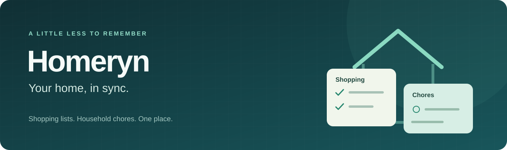

<p align="center">
  
</p>

<p align="center">
  <a href="https://github.com/mglezz/homeryn/actions/workflows/verify.yml"></a>
  <a href="https://github.com/mglezz/homeryn/releases/latest"></a>
  
  
  <a href="LICENSE"></a>
</p>

<p align="center">
  <a href="https://github.com/mglezz/homeryn/releases/latest"><strong>Download for Windows</strong></a> ·
  <a href="docs/user-guide.md">User guide</a> ·
  <a href="docs/README.md">Engineering docs</a> ·
  <a href="https://github.com/mglezz/homeryn/issues">Report a problem</a>
</p>

## A little less to remember

Homeryn keeps the shopping list and the housework together. Add milk, change a quantity, assign the kitchen to someone, or mark a chore as done. Everything stays saved for next time.

**Version 0.1.0 is a local Windows app.** Several desktop windows can share the same server on one computer. Accounts and access from other devices are future work.

| Shopping | Chores | Built to keep your changes |
| --- | --- | --- |
| Add items and quantities | Set an optional responsible person | Save locally with SQLite |
| Mark purchases and undo them | Add an optional due date | Reject stale edits from another window |
| Edit or remove entries | Complete or reopen tasks | Protect unsaved drafts and create backups |

## Up and running

1. Download **Homeryn-0.1.0-win-x64.zip** from [Releases](https://github.com/mglezz/homeryn/releases/latest).
2. Extract the **whole ZIP**, keeping the `server` folder beside the desktop executable.
3. Open **Homeryn.Desktop.exe**, click **Start server**, then choose **Shopping list** or **Chores**.

The .NET runtime is included. No SDK or Visual Studio is needed. The package is unsigned; the release includes a SHA-256 checksum and third-party notices. See the [user guide](docs/user-guide.md) for requirements, updates, and troubleshooting.

### A few useful habits

- **Add** creates an entry. Select a row, edit it, and **Save** to update it.
- **New** starts a fresh entry. Unsaved changes are protected before clearing, refreshing, or closing an idle editor.
- **Refresh** loads changes from other windows; synchronization is manual.
- After a conflict or an uncertain result, refresh before trying again.
- Back up before an update. The [backup and recovery guide](docs/user-guide.md#back-up) keeps the original data intact.

## Local by design

The server listens on `127.0.0.1:5000`. Data lives in `%LOCALAPPDATA%\Homeryn\server\homeryn.db`, separate from the app folder. The server continues running after Desktop closes; stop it with Ctrl+C in its console.

There is one shopping list and one chore list per server. Assignees are free-text names. This release has **no accounts, household permissions, cloud/LAN access, recurring tasks, or reminders**. Use it on a trusted computer. Read the [release notes](docs/releases/v0.1.0.md) for the tested scope and remaining limitations.

## For developers

Windows and the .NET 10 SDK are required to build:

```powershell
dotnet build Homeryn.slnx --configuration Release --warnaserror
dotnet run --project tests/Homeryn.IntegrationTests --configuration Release --no-build
```

The console runner checks framing, concurrency, persistence, migrations, malformed responses, editor behavior, and backup recovery. `dotnet test` does not execute it. CI also builds and smoke-tests the portable ZIP before integration.

```text
Windows Forms desktop  -- framed JSON / TCP -->  Local server  -->  SQLite
Shopping · Chores                               Validation         Persistence
Draft protection                               Version checks     Backups
```

| Explore | Purpose |
| --- | --- |
| [Development guide](docs/development.md) | Setup, conventions, and Git workflow |
| [Architecture](docs/architecture.md) · [Protocol](docs/protocol.md) | How the parts fit together |
| [Verification](tests/README.md) | Automated checks and manual evidence |
| [Release process](docs/releasing.md) | Build, test, tag, and publish |
| [Contributing](CONTRIBUTING.md) | Focused changes and useful bug reports |

## Why Homeryn?

I started Homeryn as my final project for Distributed Systems and Parallel Programming. I also want to grow it into a useful application and a project for my portfolio: small steps, understandable decisions, and features that work from end to end.

Made by [Marcos González Hidalgo](https://github.com/mglezz). Homeryn's code is available under the [MIT license](LICENSE).
