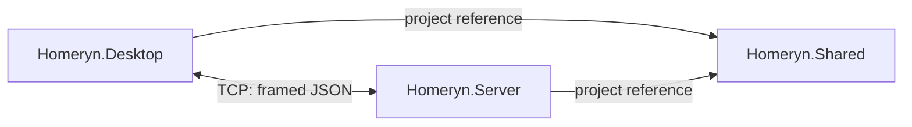

# Architecture

## Scope

The current implementation provides one persistent shopping list and one chore list per local server. Chores support optional free-text assignment, optional due dates, and completion. Household identity and membership remain pending.

| Project | Responsibility | Production dependencies |
| --- | --- | --- |
| Homeryn.Server | Accept requests, validate shopping and chore operations, and persist records. | Homeryn.Shared, Microsoft.Data.Sqlite 10.0.13 |
| Homeryn.Desktop | Host forms, send requests, and display results and conflicts. | Homeryn.Shared |
| Homeryn.Shared | Define transport contracts, shopping and chore DTOs, and JSON framing. | .NET libraries |

A separate executable verification project under `tests/` references both applications to exercise the actual server and desktop connection service. This does not introduce a production dependency between Server and Desktop.



## Repository layout

```text
Homeryn/
├── src/
│   ├── Homeryn.Server/
│   │   └── Networking/
│   ├── Homeryn.Desktop/
│   │   ├── Forms/
│   │   └── Networking/
│   └── Homeryn.Shared/
│       ├── Contracts/
│       └── Communication/
├── tests/
│   └── Homeryn.IntegrationTests/
├── docs/
├── Homeryn.slnx
├── README.md
└── .gitignore
```

Server now also contains `Shopping/` for application rules and the repository interface, and `Persistence/` for SQLite. Shared contains `Shopping/` for DTOs and command identifiers. Desktop contains `Hosting/` for launching the separately built local server. No production project reference connects Server and Desktop.

Server and Shared also contain `Chores/` for chore rules, repository contracts, and DTOs. `ChoresForm`, `ChoresClient`, `ChoresService`, and `SqliteChoreRepository` follow the same boundaries as shopping. `SqliteDatabase` initializes and migrates the shared schema; both features use the dispatcher's storage gate.

## Connection lifecycle

The server binds to IPv4 loopback at `127.0.0.1:5000`. It accepts connections asynchronously and starts one asynchronous handler per connection. Requests are processed sequentially within a connection; different connections can progress independently.

Asynchronous I/O avoids a dedicated thread or `Task.Run` for each client. This milestone demonstrates concurrent network handling. CPU-bound parallel processing has not been implemented or measured; any separate assessment requirement remains to be defined.

The server retains handler tasks, removes successfully completed tasks during subsequent accepts, and awaits the remaining tasks during shutdown. Ctrl+C cancels pending accepts, reads, and writes. Each handler disposes its client connection.

Each desktop request has a five-second timeout covering connect, write, and read. Each exchange opens and closes a connection. A list refresh uses several bounded pages. A successful request does not establish a persistent session or subscription.

## Boundaries and future work

The form manages selection, button state, cancellation, and feedback. `ShoppingListClient` validates responses; `TcpClientService` handles socket exchanges. `RequestDispatcher` selects operations, `ShoppingListService` enforces rules, and `SqliteShoppingItemRepository` executes parameterized SQL. `IShoppingItemRepository` keeps storage details outside application rules.

SQLite calls are synchronous: Microsoft.Data.Sqlite does not implement asynchronous file I/O. The dispatcher waits asynchronously on a semaphore before offloading one storage operation to `Task.Run`. This bounds active storage work to one operation per server and keeps the accept loop and PING responsive. Each operation owns its connection; SQLite lock retries use a two-second timeout. Updates and deletes also use transactional version checks, so correctness does not depend only on the in-process semaphore. See [Microsoft's SQLite guidance](https://learn.microsoft.com/en-us/dotnet/standard/data/sqlite/async).

Authentication, authorization, push events, connection quotas, idle deadlines, encryption, and a web endpoint remain outside this local prototype. The waiting request queue is not bounded. Payloads are limited to 4,096 bytes; shopping uses pages of five items and chores use pages of three. A browser client will need an HTTP/WebSocket adapter. See the [shopping increment](shopping-list.md) for persistence, concurrency, and failure semantics.
