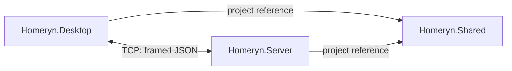

# Architecture

## Scope

I implement a local communication foundation with three application projects. I defer household operations and SQLite persistence until I specify their behavior. I retain the existing shopping-list and chore forms as UI placeholders; I do not treat them as implemented features.

| Project | Responsibility | Production dependencies |
| --- | --- | --- |
| Homeryn.Server | I accept TCP connections and dispatch the initial diagnostic request. | Homeryn.Shared |
| Homeryn.Desktop | I host Windows Forms and perform an asynchronous connection check. | Homeryn.Shared |
| Homeryn.Shared | I define the request/response contracts and shared JSON framing. | .NET libraries |

I add a separate executable verification project under `tests/`. Its references to both applications let me exercise the actual server and desktop connection service without introducing a production dependency between them.



## Repository layout

```text
Homeryn/
├── src/
│   ├── Homeryn.Server/
│   │   └── Networking/
│   ├── Homeryn.Desktop/
│   │   ├── Forms/
│   │   └── Networking/
│   └── Homeryn.Shared/
│       ├── Contracts/
│       └── Communication/
├── tests/
│   └── Homeryn.IntegrationTests/
├── docs/
├── Homeryn.slnx
├── README.md
└── .gitignore
```

I create model, service, and data directories when I have concrete implementations for them. I remove the initial empty classes rather than commit speculative APIs.

## Connection lifecycle

I bind the executable server to IPv4 loopback, `127.0.0.1:5000`. I accept connections asynchronously and start one asynchronous handler per connection. I process requests sequentially within each connection and allow different connections to progress independently.

I use asynchronous I/O rather than a dedicated thread or `Task.Run` for each client. This milestone demonstrates concurrent network handling. I have not implemented or measured CPU-bound parallel processing; I will address any separate parallel-programming requirement once I know the assessment criteria.

I retain active handler tasks, discard successfully completed tasks during subsequent accepts, and await the remaining tasks during shutdown. I cancel pending accepts, reads, and writes when I receive Ctrl+C. I dispose each client in its handler.

I give the desktop diagnostic operation a five-second timeout covering connect, write, and read. I open a connection for each check and close it afterwards. I do not represent a successful diagnostic as a persistent session or subscription.

## Boundaries and future work

I keep socket operations out of the form's event handler. I reserve the form for button state, cancellation on close, and user feedback. I will put household rules in server-side services and persistence in a separate data layer within the server project.

I have not added SQLite packages, authentication, authorization, synchronization events, or a web endpoint. I will need an HTTP/WebSocket interface for a browser client, because browser code cannot directly use this raw TCP protocol. I intend to reuse the server-side application logic and data through that future interface.

I keep the server local for this milestone. I do not claim production readiness: I have not added connection quotas, idle deadlines, encryption, or persistence. I cap individual JSON payloads at 4,096 bytes to bound per-message allocation.
