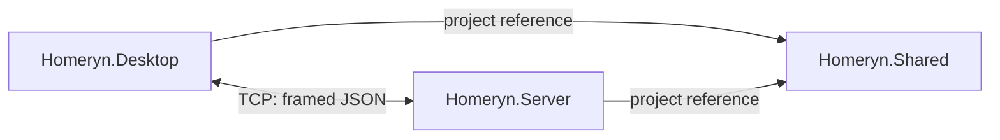

# Architecture

## Scope

The current implementation provides local communication through three application projects. Household operations and SQLite persistence remain pending. The shopping-list and chore forms are UI placeholders.

| Project | Responsibility | Production dependencies |
| --- | --- | --- |
| Homeryn.Server | Accept TCP connections and handle diagnostic requests. | Homeryn.Shared |
| Homeryn.Desktop | Host Windows Forms and perform an asynchronous connection check. | Homeryn.Shared |
| Homeryn.Shared | Define request/response classes and shared JSON framing. | .NET libraries |

A separate executable verification project under `tests/` references both applications to exercise the actual server and desktop connection service. This does not introduce a production dependency between Server and Desktop.



## Repository layout

```text
Homeryn/
├── src/
│   ├── Homeryn.Server/
│   │   └── Networking/
│   ├── Homeryn.Desktop/
│   │   ├── Forms/
│   │   └── Networking/
│   └── Homeryn.Shared/
│       ├── Contracts/
│       └── Communication/
├── tests/
│   └── Homeryn.IntegrationTests/
├── docs/
├── Homeryn.slnx
├── README.md
└── .gitignore
```

Model, service, and data directories will be added with their concrete implementations. The current solution contains no empty classes for those future responsibilities.

## Connection lifecycle

The server binds to IPv4 loopback at `127.0.0.1:5000`. It accepts connections asynchronously and starts one asynchronous handler per connection. Requests are processed sequentially within a connection; different connections can progress independently.

Asynchronous I/O avoids a dedicated thread or `Task.Run` for each client. This milestone demonstrates concurrent network handling. CPU-bound parallel processing has not been implemented or measured; any separate assessment requirement remains to be defined.

The server retains handler tasks, removes successfully completed tasks during subsequent accepts, and awaits the remaining tasks during shutdown. Ctrl+C cancels pending accepts, reads, and writes. Each handler disposes its client connection.

The desktop diagnostic has a five-second timeout covering connect, write, and read. Each check opens a connection and closes it afterwards. A successful check does not establish a persistent session or subscription.

## Boundaries and future work

The form manages button state, cancellation on close, and user feedback. Socket operations belong to the connection service. Future household rules belong in server-side services, with persistence in a separate data layer within the server project.

SQLite packages, authentication, authorization, synchronization events, and a web endpoint have not been added. A future browser client will require an HTTP/WebSocket interface because browser code cannot directly use this raw TCP protocol. Server-side application logic and data should remain reusable through that interface.

This milestone runs locally. Connection quotas, idle deadlines, encryption, and persistence are outside its scope. Individual JSON payloads are limited to 4,096 bytes to bound per-message allocation.
