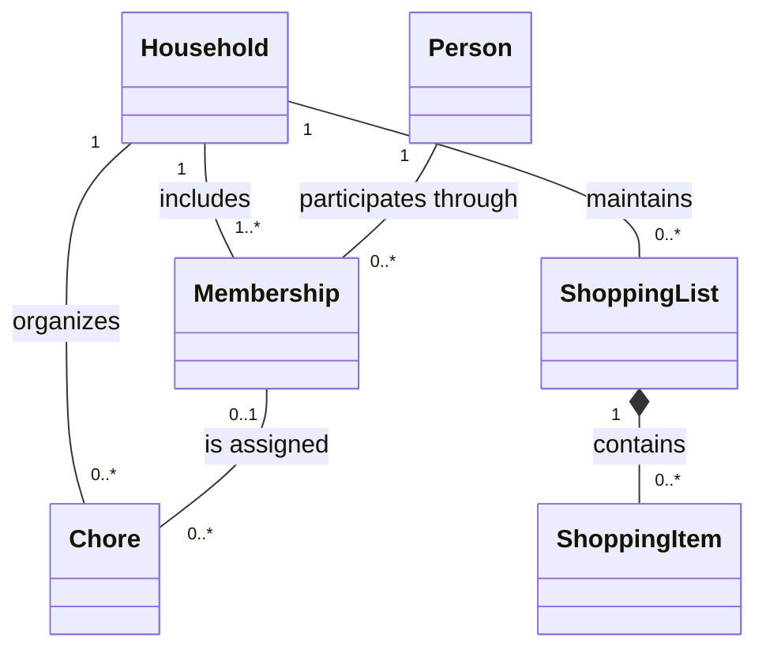

# Proposed domain model

I use this model to describe the household problem independently of C#, TCP, forms, and database tables. I have not implemented these entities or confirmed every business rule.

## Client-language description

> I want to keep the things my household needs to buy and the chores we share in one place. I want to see what still needs doing, who is taking care of it, and what is already finished.

I record this as my initial product statement, not as a quotation from an interviewed customer.

## Concepts

| Concept | Meaning I assign |
| --- | --- |
| Household | A shared home and the boundary for its shopping lists, chores, and memberships. |
| Person | An individual who may participate in a household. |
| Membership | A person's participation in a particular household. |
| Shopping list | A household's collection of things to buy. |
| Shopping item | An entry whose purchase state can be pending or purchased. |
| Chore | A household responsibility whose completion state can be pending or completed. |

I propose the following conceptual associations. I use names and multiplicities to express the domain; I do not prescribe persistence keys or C# properties here.

## Proposed constraints

I propose at least one member per household and at most one membership for the same person in the same household. I allow a chore to remain unassigned; if assigned, I require its assignee to belong to that chore's household.

I treat purchase and completion as distinct concepts. I tentatively allow a purchased item to return to pending and a completed chore to be reopened, but I defer those transitions until I detail the corresponding use cases.

## Questions I still need to resolve

- I need to decide whether a person can actively belong to several households in the first release.
- I need to define who can invite or remove members and what happens when the final member leaves.
- I need to define invitation, identity, and authentication behavior.
- I need to decide whether the first release supports one or several shopping lists per household.
- I need to define quantities, due dates, reassignment, deletion, and conflicting concurrent edits.

I will refine the model as I answer these questions rather than infer business rules from the initial empty class names.
