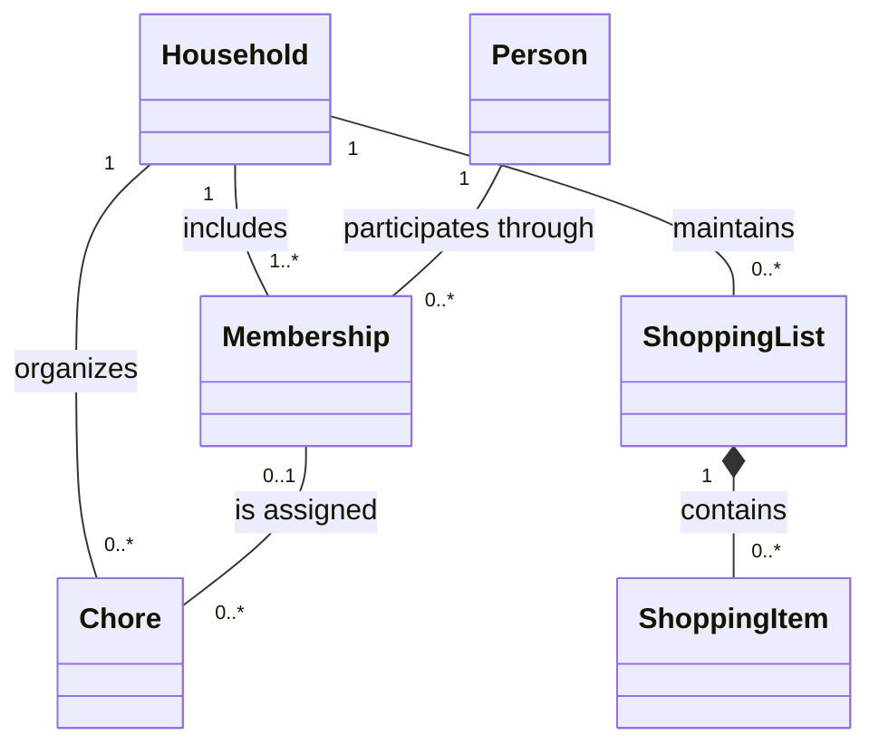

# Proposed domain model

This conceptual model describes the household problem independently of C#, TCP, forms, and database tables. Household entities and membership rules remain provisional. The current prototype implements a shopping-item subset without household identity; it does not yet implement the complete model.

## Client-language description

People sharing a home need one place to keep their shopping lists and chores. Everyone should be able to see what still needs doing, who is taking care of it, and what is already finished.

This is an initial product statement, not a quotation from an interviewed customer.

## Concepts

| Concept | Meaning |
| --- | --- |
| Household | A shared home and the boundary for its shopping lists, chores, and memberships. |
| Person | An individual who may participate in a household. |
| Membership | A person's participation in a particular household. |
| Shopping list | A household's collection of things to buy. |
| Shopping item | An entry whose purchase state can be pending or purchased. |
| Chore | A household responsibility whose completion state can be pending or completed. |

The following associations describe domain concepts and multiplicities. They do not prescribe persistence keys or C# properties.

## Proposed constraints

A household has at least one member. A person has at most one membership in the same household. A chore may remain unassigned; an assigned chore must belong to the same household as its assignee's membership.

Purchase and completion are distinct concepts. Returning a purchased item to pending and reopening a completed chore are proposed transitions, subject to the detailed use cases.

## Open questions

- Can a person actively belong to several households in the first release?
- Who can invite or remove members, and what happens when the final member leaves?
- How should invitations, identity, and authentication work?
- Does the first release support one or several shopping lists per household?
- What rules apply to quantities, due dates, reassignment, deletion, and conflicting concurrent edits?

For the local shopping subset, names contain 1–80 UTF-16 code units after trimming, quantities are integers from 1 to 999, and purchase state can change in either direction. Duplicate names are allowed as distinct entries. Deletion is permanent. Concurrent edits require the version read by the client; stale changes are rejected. These implementation decisions are detailed in [Shopping list increment](shopping-list.md). Household-level policy remains open.
