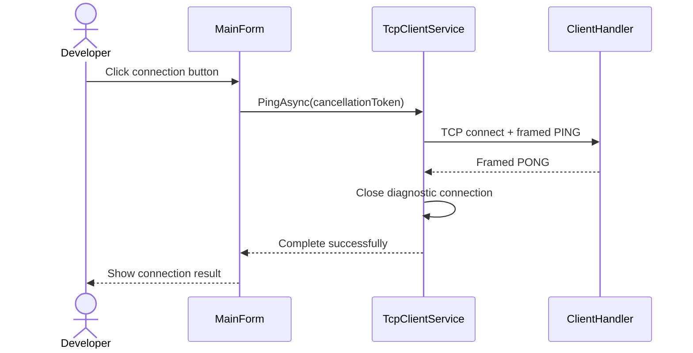

# Initial TCP protocol

The local connectivity milestone uses a request/response protocol over TCP. Wire identifiers are in English, and command values are case-sensitive.

## Framing

Each frame has the following structure:

| Field | Size | Encoding |
| --- | --- | --- |
| Payload length | 4 bytes | Signed 32-bit integer, big-endian |
| Payload | 1–4,096 bytes | UTF-8 JSON, without a byte-order mark |

The length counts payload bytes only. After detecting the beginning of a frame, `ReadExactlyAsync` completes the header and payload before JSON parsing. Only the declared payload is read, leaving any following frame for the next request.

Serialization uses `System.Text.Json` web defaults: output property names use camel case, and input property names are case-insensitive. Unrecognized properties are tolerated. Message boundaries depend on the length prefix, not line delimiters or TCP packet sizes.

## Messages

Request payload:

```json
{"command":"PING"}
```

Success payload:

```json
{"status":"PONG","error":null}
```

A nonempty, unsupported command produces:

```json
{"status":"ERROR","error":"UNKNOWN_COMMAND"}
```

Malformed JSON, a null/non-object request, or a missing, blank, null, or incorrectly typed command produces:

```json
{"status":"ERROR","error":"INVALID_REQUEST"}
```

The entire frame is consumed before JSON parsing, allowing another request on the same connection after a request error. An invalid length or truncated header/payload closes the affected connection without a response. End-of-stream between frames is a normal disconnection. Other clients remain unaffected.

## Ordering and lifetime

A connection supports multiple sequential requests, with one response per complete valid-length request frame. Responses preserve request order. Concurrent writers on the same stream, request identifiers, unsolicited events, and retries are not supported.

Each desktop diagnostic performs one exchange. Success requires a `PONG` response with a null or absent error value. The connection closes after success, failure, cancellation, or timeout.



This is an initial internal contract. Versioning and request correlation must be defined before incompatible messages or server notifications are introduced.
