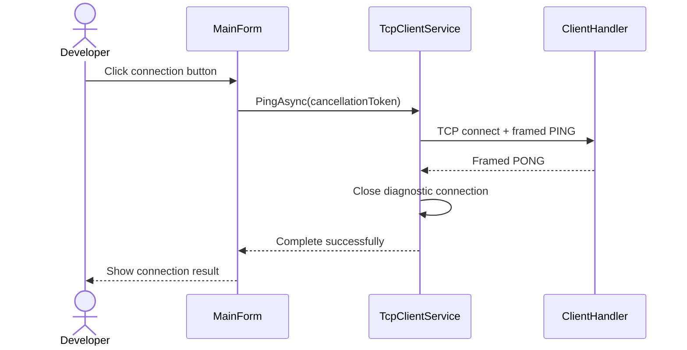

# Initial TCP protocol

The local prototype uses a request/response protocol over TCP for diagnostics and shopping operations. Wire identifiers are in English, and command values are case-sensitive.

## Framing

Each frame has the following structure:

| Field | Size | Encoding |
| --- | --- | --- |
| Payload length | 4 bytes | Signed 32-bit integer, big-endian |
| Payload | 1–4,096 bytes | UTF-8 JSON, without a byte-order mark |

The length counts payload bytes only. After detecting the beginning of a frame, `ReadExactlyAsync` completes the header and payload before JSON parsing. Only the declared payload is read, leaving any following frame for the next request.

Serialization uses `System.Text.Json` web defaults: output property names use camel case, and input property names are case-insensitive. Unrecognized properties are tolerated. Message boundaries depend on the length prefix, not line delimiters or TCP packet sizes.

## Messages

Request payload:

```json
{"command":"PING"}
```

Success payload:

```json
{"status":"PONG","error":null}
```

A nonempty, unsupported command produces:

```json
{"status":"ERROR","error":"UNKNOWN_COMMAND"}
```

Malformed JSON, a null/non-object request, or a missing, blank, null, or incorrectly typed command produces:

```json
{"status":"ERROR","error":"INVALID_REQUEST"}
```

The entire frame is consumed before JSON parsing, allowing another request on the same connection after a request error. An invalid length or truncated header/payload closes the affected connection without a response. End-of-stream between frames is a normal disconnection. Other clients remain unaffected.

## Shopping messages

Examples omit unused optional fields. The serializer also emits null and default fields; receivers must tolerate these. All shopping successes use `status: "OK"` and `error: null`.

| Command | Request fields | Success data |
| --- | --- | --- |
| LIST_ITEMS | `afterItemId` (default 0), `upperBoundId` (initially null) | `page` |
| ADD_ITEM | `item`: name, quantity, isPurchased | Stored `item` |
| UPDATE_ITEM | `itemId`, `expectedVersion`, complete `item` | Updated `item` |
| DELETE_ITEM | `itemId`, `expectedVersion` | No item or page |

```json
{"command":"ADD_ITEM","item":{"name":"Milk","quantity":2,"isPurchased":false}}
```

```json
{"status":"OK","error":null,"item":{"id":1,"name":"Milk","quantity":2,"isPurchased":false,"version":1},"page":null}
```

```json
{"command":"UPDATE_ITEM","itemId":1,"expectedVersion":1,"item":{"name":"Milk","quantity":3,"isPurchased":true}}
```

An omitted `isPurchased` defaults to false; updates replace all three editable fields. Missing or incorrectly typed required values must not be interpreted as a partial update.

```json
{"command":"LIST_ITEMS","afterItemId":0}
```

```json
{"status":"OK","error":null,"item":null,"page":{"items":[{"id":1,"name":"Milk","quantity":3,"isPurchased":true,"version":2}],"upperBoundId":1,"nextAfterId":null}}
```

Continue with `afterItemId` equal to `nextAfterId` and the returned `upperBoundId` until `nextAfterId` is null. Each page contains at most five items, ordered by increasing identifier. The desktop rejects unordered/out-of-bound identifiers and non-advancing cursors. A refresh is not a snapshot across all pages; see [read semantics](shopping-list.md#reads-and-failures).

| Error | Meaning |
| --- | --- |
| INVALID_ITEM | The item payload is missing. |
| INVALID_NAME | The trimmed name is blank, too long, or contains control characters. |
| INVALID_QUANTITY | Quantity is outside 1–999. |
| INVALID_ITEM_VERSION | Identifier or expected version is invalid. |
| INVALID_PAGE | A cursor is negative or exceeds the upper bound. |
| ITEM_NOT_FOUND | The item no longer exists. |
| ITEM_CONFLICT | The stored version differs from the expected version. |
| STORAGE_UNAVAILABLE | SQLite could not complete the operation, including a lock timeout. |

These errors use the same `ERROR` envelope as protocol errors. Incorrect JSON value types produce `INVALID_REQUEST`. Unknown properties are ignored. No household identity or authorization field exists in this local contract.

## Ordering and lifetime

A connection supports multiple sequential requests, with one response per complete valid-length request frame. Responses preserve request order. Concurrent writers on the same stream, request identifiers, unsolicited events, and retries are not supported.

Each desktop request performs one exchange. Diagnostic success requires `PONG` with a null or absent error value; shopping success requires `OK` and the expected data. The connection closes after success, failure, cancellation, or timeout. A mutation may have committed before a connection failure; refresh before repeating it. Requests do not have idempotency keys.



This is an initial internal contract. Versioning and request correlation must be defined before incompatible messages or server notifications are introduced.
