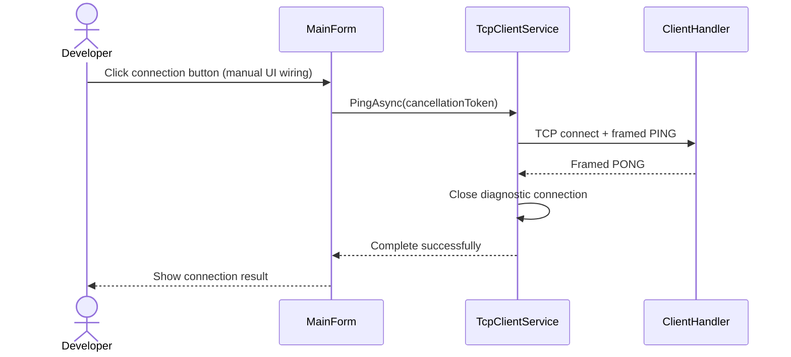

# Initial TCP protocol

I define a request/response protocol over TCP for the local connectivity milestone. I keep wire identifiers in English and command values case-sensitive.

## Framing

I encode each frame as:

| Field | Size | Encoding |
| --- | --- | --- |
| Payload length | 4 bytes | Signed 32-bit integer, big-endian |
| Payload | 1–4,096 bytes | UTF-8 JSON, without a byte-order mark |

I measure the length in bytes, excluding the header. I use `ReadExactlyAsync` after detecting the beginning of a frame so that fragmented headers and payloads are reconstructed before JSON parsing. I read only the declared payload, leaving any following frame for the next request.

I use `System.Text.Json` web defaults: I write camel-case property names and accept property names case-insensitively. I tolerate unrecognized properties in this initial protocol. I do not use line delimiters, pretty-printed message boundaries, or assumptions about TCP packet sizes.

## Messages

I send the following request payload:

```json
{"command":"PING"}
```

I return the following success payload:

```json
{"status":"PONG","error":null}
```

I return an error for a nonempty, unsupported command:

```json
{"status":"ERROR","error":"UNKNOWN_COMMAND"}
```

I return an error for malformed JSON, a null/non-object request, or a missing, blank, null, or incorrectly typed command:

```json
{"status":"ERROR","error":"INVALID_REQUEST"}
```

I consume the entire frame before parsing its JSON, so I can continue reading the same connection after a request error. I close the connection without a response when the declared length is invalid or the header/payload is truncated. I treat end-of-stream between frames as a normal disconnection. I isolate these failures to the affected client.

## Ordering and lifetime

I support multiple sequential requests on one connection and return one response per complete valid-length request frame. I preserve request order on that connection. I do not support concurrent writers on the same stream, request identifiers, unsolicited events, or retries.

I use only one exchange per desktop diagnostic call. I require a `PONG` response with a null or absent error value before reporting success. I close that connection after the result, a failure, cancellation, or timeout.



I treat this protocol as an initial internal contract, not a stable public API. I will define versioning and request correlation before introducing incompatible messages or server notifications.
