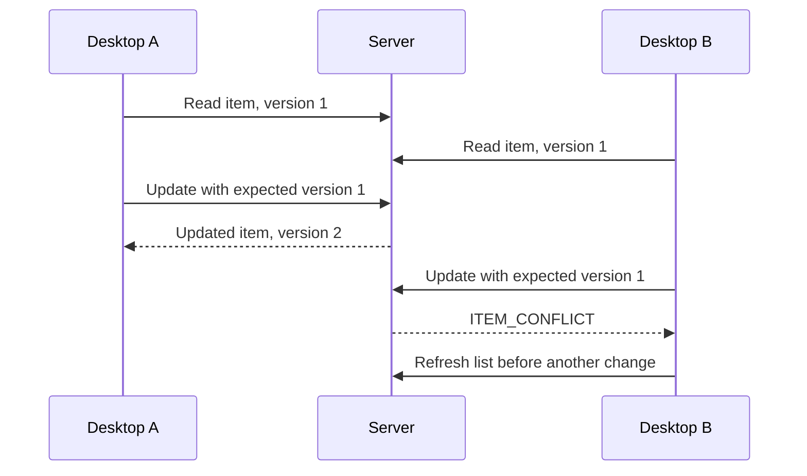

# Persistent shopping list increment

## Scope

One server owns one shared list. Every local client has the same access. This is a development prototype with no accounts, household membership, or permissions. Multiple desktop processes communicate with the same server over loopback TCP; they never open the database directly.

The application supports adding an item, reading the list, replacing an item's name, quantity and purchase state, and deleting an item. Duplicate names are allowed; identifiers distinguish entries. Quantities represent whole units, without prices or units of measurement.

## Application rules

- Trim surrounding whitespace from names. Require 1–80 UTF-16 code units after trimming and reject remaining control characters.
- Require an integer quantity from 1 to 999.
- Permit pending-to-purchased and purchased-to-pending transitions.
- Assign an identifier and version 1 when adding an item.
- Require a positive identifier and the previously read version for updates and deletes. Reserve `long.MaxValue` as an invalid expected version to prevent overflow.
- Increment the version once per successful update. Reject stale updates and deletes without changing storage.
- Remove deleted items permanently. Do not reuse identifiers.

The server is authoritative. Desktop controls improve feedback, but direct TCP requests receive the same validation.

## Storage model

SQLite schema version 1 uses one `ShoppingItems` table:

| Column | Storage | Constraint |
| --- | --- | --- |
| Id | INTEGER | Autoincrement primary key |
| Name | TEXT | Required; database length 1–80, with stricter application validation above |
| Quantity | INTEGER | Required; 1–999 |
| IsPurchased | INTEGER | Required; 0 or 1 |
| Version | INTEGER | Required; positive |

All user values use SQL parameters. Each operation opens and disposes its own connection. WAL mode is enabled at initialization. Pooling is disabled for this small local workload so connection lifetimes and test-file cleanup remain explicit.

The default file is `%LOCALAPPDATA%\Homeryn\server\homeryn.db`; `--database <path>` overrides it. Schema creation and the version marker are committed together. Existing version-1 databases are reused, and newer versions are rejected. Future schema changes require an explicit migration plan.

## Concurrent writes

Updates use `WHERE Id = $id AND Version = $version` within a transaction. A successful update returns the stored item with its incremented version. If no row matches, an existence check in the same transaction distinguishes `ITEM_NOT_FOUND` from `ITEM_CONFLICT`. Deletes follow the same rule.

The server serializes its own storage operations while continuing asynchronous network handling. Database transactions and version predicates also protect against a second process using the same file. SQLite lock waits are bounded by a two-second provider timeout; the client request timeout is five seconds.

## Reads and failures

Pages contain at most five items so maximum-length escaped names fit in the existing 4,096-byte frame limit. The first page records the current maximum identifier. Subsequent pages use an exclusive lower cursor and the same inclusive upper bound. Deleting an earlier row does not shift later pages; additions above the captured boundary appear on the next refresh.

Each page is internally consistent, but the entire refresh is not a database snapshot. Concurrent updates and deletions can be visible between pages. There is no automatic push notification or background refresh.

A disconnected or timed-out client cannot assume a write failed: the database may have committed before the response was lost. The desktop keeps the entered values, disables further mutations, and requires a refresh. There is no automatic mutation retry or exactly-once delivery guarantee. Refresh clears the editor, so users must review the current list before repeating a change.

## Acceptance criteria

1. Two clients can read the same committed items.
2. Names, quantities, purchase state, versions, and deletions survive a server restart.
3. Invalid requests do not change storage or stop other clients.
4. Two concurrent updates of one version yield exactly one success and one conflict.
5. A stale delete cannot remove a more recently edited item.
6. Lists larger than one frame are retrieved without truncation or duplicate identifiers.
7. A locked database yields a bounded error, while PING remains responsive.
8. The desktop reports failed or uncertain operations, preserves the editor on failure, and cancels pending work when closed.

Automated and interactive evidence is recorded in [Verification](../tests/README.md). This increment does not demonstrate CPU-bound parallel processing or remote deployment.
